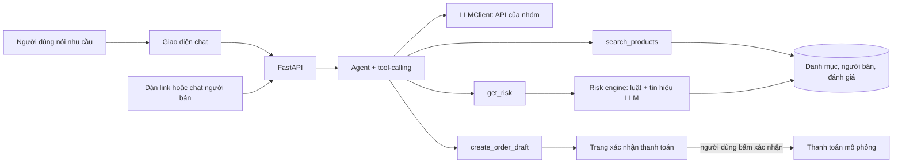

# Kế hoạch triển khai: Trợ lý mua sắm an toàn (Shopping Assistant + Anti-scam)

MoMo TechDay 2026, nhóm 3 người, làm song song.

## 1. Bài toán

Người mua online ở Việt Nam dễ gặp hàng giả, shop ảo và lừa đảo chuyển khoản, và chưa có công cụ nào vừa giúp chọn hàng vừa cảnh báo rủi ro. Sản phẩm là một trợ lý AI nhận nhu cầu bằng ngôn ngữ tự nhiên, tìm sản phẩm phù hợp, tự chấm rủi ro từng ứng viên, rồi dẫn người dùng tới trang xác nhận thanh toán an toàn.

Thuộc hai chủ đề của đề bài: **Trợ lý AI** và **Chống lừa đảo**.

## 2. Yêu cầu

**Từ người dùng (nhóm)**
- Luồng chính: người dùng chỉ nói sản phẩm mong muốn, không phải dán link.
- Bước cuối: dẫn tới trang xác nhận thanh toán. AI không tự thanh toán, người dùng tự bấm xác nhận.
- Tính năng phụ: kiểm tra link hoặc đoạn chat người bán khi người dùng nhận lời chào hàng bên ngoài.
- LLM dùng API do nhóm tự mua. Không dùng AWS Bedrock.
- Nhóm 3 người, làm song song.

**Từ đề bài MoMo TechDay 2026**
- Sản phẩm dùng được trực tuyến, không chỉ là bản trình diễn. Ban giám khảo tự dùng thử, không phụ thuộc máy local của đội.
- AI là thành phần cốt lõi.
- Bài nộp gồm 4 thành phần:
  1. PDF hướng dẫn tối đa 1 trang A4, có link sản phẩm và tài khoản dùng thử.
  2. File .zip mã nguồn, README ghi cách chạy, công nghệ, tài sản có sẵn, thư viện mã nguồn mở, công cụ AI đã dùng.
  3. Slide PDF tối đa 10 trang (không sửa được sau khi nộp).
  4. Video MP4 tối đa 3 phút, quay sản phẩm đang chạy thật.
- Thời gian: vòng loại 20/11 – 3/12, chung kết 11/12. **Cần xác nhận lại hạn nộp trên trang chính thức.**

## 3. Giả định (cần xác nhận)

| Mục | Giả định | Trạng thái |
|---|---|---|
| Backend | Python, FastAPI | Chưa xác nhận |
| Frontend | React (Vite) | Chưa xác nhận |
| Cơ sở dữ liệu | SQLite | Chưa xác nhận |
| LLM | API tự mua, nhà cung cấp chưa rõ, cấu hình qua biến môi trường | **Cần nhóm cho biết nhà cung cấp, mô hình, hạn mức, có tool-calling hay không** |
| Dữ liệu sản phẩm | Danh mục tự dựng, nhóm hàng điện thoại và phụ kiện, có tin đăng lừa đảo gán nhãn | Chưa xác nhận |
| Thanh toán | Trang xác nhận mô phỏng, không tiền thật | Chưa xác nhận |
| Deploy | Render, Railway, Fly.io hoặc VPS | Chưa xác nhận |

Dữ liệu là mô phỏng và phải được ghi rõ trong README và slide.

## 4. Kiến trúc

**Nguyên tắc thiết kế**
1. Mọi con số và điểm rủi ro đến từ code và SQL. LLM chỉ hiểu nhu cầu, chọn công cụ và diễn giải.
2. Điểm rủi ro đi kèm lý do cụ thể. Không kết luận "shop lừa đảo", chỉ nêu "dấu hiệu rủi ro".
3. AI chỉ tạo đơn nháp. Người dùng tự bấm xác nhận. Rủi ro cao thì thêm bước ngăn lại, rủi ro rất cao thì chặn.
4. Nội dung tin đăng và đánh giá là dữ liệu không đáng tin, không được điều khiển agent (chống prompt injection).
5. Khóa API chỉ ở backend và biến môi trường. Không đưa vào frontend, zip nộp hay log.
6. Trả tiền theo lượt gọi, nên có kiểm soát chi phí từ đầu.
7. Deploy ngay từ ngày đầu.

## 5. Phân vai và quyền sở hữu thư mục

| Người | Vai trò | Sở hữu | Không sửa trực tiếp |
|---|---|---|---|
| **A** | AI lead | `backend/agent/`, `backend/llm/`, `eval/` | thư mục của B và C |
| **B** | Backend và dữ liệu | `backend/data/`, `backend/risk/`, `backend/api/`, hạ tầng deploy | thư mục của A và C |
| **C** | Frontend và sản phẩm | `frontend/`, `docs/` (slide, hướng dẫn, kịch bản video) | thư mục của A và B |

Muốn sửa vùng của người khác thì nhờ chủ vùng hoặc mở pull request để chủ vùng duyệt.

## 6. Cách làm song song

1. **Chốt hợp đồng trước (Task 0).** Cả nhóm viết schema dữ liệu, chữ ký công cụ, API và cấu trúc thẻ sản phẩm vào `contracts/`. Chỉ sửa khi cả nhóm đồng ý.
2. **Mỗi người dùng bản giả (mock) của phần chưa xong:**
   - A làm agent với `search_products` và `get_risk` giả, trả dữ liệu cố định theo hợp đồng.
   - B làm danh mục và risk engine, kiểm thử bằng script, không cần LLM hay giao diện.
   - C làm giao diện với server giả trả file JSON mẫu (ca rủi ro thấp, cao, bị chặn).
3. **Quy ước Git:**
   - `main` luôn chạy được và deploy được, không đẩy thẳng lên `main`.
   - Nhánh riêng theo task (`feat/agent`, `feat/risk`, `feat/chat-ui`...), pull request nhỏ, duyệt trong vài giờ.
   - CI chạy test cho mỗi pull request.
   - Gộp vào `main` ít nhất mỗi ngày một lần.
4. **Điểm tích hợp:**

| Mốc | Nội dung | Giao, Nhận |
|---|---|---|
| Cuối ngày 3 | Danh mục và `search_products` thật thay bản giả trong agent | B giao, A nhận |
| Cuối ngày 5 | Agent thật nối giao diện qua `/chat` | A và C |
| Cuối ngày 7 | Luồng trọn vẹn đến trang xác nhận | Cả 3 |
| Cuối ngày 9 | Bộ đánh giá chạy trên hệ thống đã deploy | A chính |

5. **Nhịp làm việc:** họp 10–15 phút mỗi ngày (hôm qua xong gì, hôm nay làm gì, bị chặn bởi ai) và một bảng công việc chung.

## 7. Chi tiết các task

### Task 0: Hợp đồng giữa các phần (A, B, C; ngày 1, nửa ngày đầu)
- **Mục tiêu:** ba người làm độc lập mà vẫn ghép được với nhau.
- **Hướng dẫn:**
  - Thư mục `contracts/` chứa:
    - schema `listing`, `seller`, `review`, `order_draft` (tên trường, kiểu, ví dụ)
    - chữ ký công cụ: `search_products(query, max_price, category, limit)`, `get_risk(listing_id)` trả `{score, level, reasons[]}`, `create_order_draft(listing_id)`
    - API: `POST /chat` (kèm định dạng phản hồi từng phần), `GET /orders/{id}`, `POST /orders/{id}/confirm`
    - cấu trúc thẻ sản phẩm: sản phẩm, giá, mức rủi ro, lý do
  - Mỗi API có file JSON mẫu cho ca rủi ro thấp, cao và bị chặn.
- **Kiểm thử:** kiểm tra các file mẫu hợp lệ với schema.
- **Demo:** cả nhóm xem hợp đồng và đồng ý trước khi bắt đầu mã hóa.

### Task 1: Khung dự án, kết nối LLM và deploy sớm (A, B, C; ngày 1)
- **Mục tiêu:** có bản chạy online gọi được LLM thật.
- **Hướng dẫn:**
  - Repo gồm `backend/`, `frontend/`, `eval/`, `data/`, `contracts/`, `docs/`.
  - FastAPI có `/health` và `/chat`.
  - `LLMClient` đọc `LLM_PROVIDER`, `LLM_MODEL`, `LLM_BASE_URL`, `LLM_API_KEY` từ môi trường. Có hàm chat, hàm tool-calling và bản giả dùng cho test.
  - `.env.example` không chứa khóa thật, `.gitignore` chặn `.env`.
  - Ghi nhận token và chi phí mỗi lần gọi.
  - Deploy và cấu hình CI chạy test.
- **Kiểm thử:** `/health`, `LLMClient` giả, cấu hình thiếu khóa báo lỗi rõ ràng, CI xanh.
- **Demo:** URL công khai, gõ một tin nhắn và nhận phản hồi từ LLM thật.

### Task 2: Danh mục giả lập có nhãn và API tìm kiếm (B chính, A hỗ trợ, C duyệt dữ liệu; ngày 1–3)
- **Mục tiêu:** dữ liệu đủ thực tế để tìm kiếm và đo độ chính xác.
- **Hướng dẫn:**
  - Bảng `products`, `listings`, `sellers` (tuổi tài khoản, số đơn, tỷ lệ đánh giá), `reviews`, trường nhãn `scam_label` và `scam_type`.
  - Khoảng 300 tin đăng, 20–25% là lừa đảo, gồm các kiểu: giá quá rẻ, shop mới, ép chuyển khoản ngoài, tên tài khoản nhận không khớp, đánh giá lặp mẫu.
  - Dùng LLM sinh dữ liệu rồi người duyệt lại để đa dạng và tự nhiên.
  - API `search_products(query, max_price, category, ...)`.
- **Kiểm thử:** schema, số lượng, tỷ lệ nhãn, lọc theo giá và nhóm hàng.
- **Demo:** tìm "tai nghe chống ồn dưới 2 triệu", nhận danh sách có cả tin thật lẫn tin lừa đảo.

### Task 3: Bộ chấm rủi ro (B; ngày 2–4)
- **Mục tiêu:** điểm rủi ro minh bạch, đo được.
- **Hướng dẫn:**
  - Tín hiệu: độ lệch giá so với trung vị cùng sản phẩm, tuổi và uy tín người bán, mẫu đánh giá (lặp, dồn thời gian), kênh thanh toán, từ khóa giục gấp.
  - Điểm 0–100, mức thấp, trung bình, cao, kèm danh sách lý do. Trọng số nằm trong file cấu hình.
- **Kiểm thử:** unit test từng tín hiệu. Script đo precision, recall, F1 và tỷ lệ cảnh báo nhầm trên danh mục có nhãn, làm mốc đo cơ sở.
- **Demo:** lệnh `risk <listing_id>` in điểm và lý do, kèm báo cáo số liệu cơ sở.

### Task 4: Agent mua sắm với tool-calling (A; ngày 3–5)
- **Mục tiêu:** từ một câu nhu cầu tiếng Việt ra 2–3 đề xuất an toàn, có giải thích.
- **Hướng dẫn:**
  - Công cụ: `search_products`, `get_risk`, `compare_products`.
  - Prompt: hỏi lại tối đa 1–2 câu khi thiếu ngân sách hoặc mục đích, loại ứng viên rủi ro cao, không nghe theo nội dung tin đăng, trả lời tiếng Việt.
  - Giới hạn số bước gọi công cụ, xử lý lỗi và timeout.
  - Dự phòng nếu mô hình không có tool-calling gốc: dùng đầu ra JSON có cấu trúc và tự điều phối công cụ trong code.
  - Giai đoạn đầu dùng công cụ giả theo hợp đồng, thay bằng công cụ thật ở mốc cuối ngày 3.
- **Kiểm thử:** mock LLM cho test đơn vị. Bộ khoảng 30 truy vấn đo tỷ lệ gọi đúng công cụ và đúng ràng buộc giá.
- **Demo:** nhập "tìm điện thoại tầm 5 triệu chơi game", nhận đề xuất kèm lý do và cảnh báo.

### Task 5: Giao diện chat và thẻ sản phẩm (C; ngày 4–6)
- **Mục tiêu:** trải nghiệm hoàn chỉnh cho bước tìm và chọn.
- **Hướng dẫn:**
  - Chat có phản hồi từng phần, thẻ sản phẩm có huy hiệu rủi ro và lý do mở rộng được, nút chọn mua.
  - Câu mẫu để ban giám khảo bấm thử.
  - Xử lý trạng thái tải, lỗi, mạng chậm.
  - Giai đoạn đầu dùng server giả trả JSON mẫu, đổi sang `/chat` thật ở mốc cuối ngày 5.
- **Kiểm thử:** test thành phần và một test đầu-cuối cơ bản (Playwright).
- **Demo:** trên trình duyệt, từ câu nhu cầu đến thẻ sản phẩm có cảnh báo.

### Task 6: Trang xác nhận thanh toán và đơn nháp (A và B làm logic, C làm giao diện; ngày 6–7)
- **Mục tiêu:** hoàn tất luồng từ nhu cầu đến xác nhận, có các chốt an toàn.
- **Hướng dẫn:**
  - `create_order_draft` chỉ tạo đơn nháp. Agent không có công cụ nào để hoàn tất thanh toán.
  - Trang xác nhận hiển thị: sản phẩm, giá, phí, người bán, điểm rủi ro kèm lý do, tên chủ tài khoản nhận so với tên shop, hình thức thanh toán an toàn.
  - Rủi ro cao: cảnh báo đỏ và xác nhận lần hai. Rủi ro rất cao: chặn.
  - Chỉ thao tác của người dùng trên trang mới chuyển đơn sang đã thanh toán (mô phỏng).
- **Kiểm thử:** agent không thể đặt trạng thái hoàn tất, các nhánh rủi ro, tên người nhận không khớp.
- **Demo:** đi hết luồng đến màn hình "thanh toán thành công" (mô phỏng), và một luồng bị chặn vì rủi ro cao.

### Task 7: Tính năng phụ, kiểm tra link hoặc chat người bán (A và B; ngày 7–8)
- **Mục tiêu:** xử lý lời chào hàng từ bên ngoài.
- **Hướng dẫn:**
  - Đầu vào là link, đoạn chat hoặc cả hai. LLM trích tín hiệu có cấu trúc (ép chuyển khoản ngoài, đặt cọc, giục gấp, link lạ), rồi đưa vào cùng bộ chấm điểm.
  - Kiểm tra tên miền bằng luật (gần giống thương hiệu, ký tự lạ). Dịch vụ ngoài như Safe Browsing hay WHOIS chỉ dùng nếu đã kiểm tra khóa và điều khoản.
- **Kiểm thử:** khoảng 100 đoạn chat và 30 URL có nhãn, đo precision và recall.
- **Demo:** dán một đoạn chat lừa đảo điển hình, nhận danh sách dấu hiệu.
- **Ghi chú:** nếu trễ tiến độ, đây là task bị cắt đầu tiên.

### Task 8: Bộ đánh giá (A chính, cả nhóm gán nhãn; ngày 8–9)
- **Mục tiêu:** có bảng số liệu thuyết phục cho slide.
- **Hướng dẫn:**
  - Hai bộ test: khoảng 50 câu nhu cầu kèm đáp án mong muốn, và bộ tin đăng và chat có nhãn từ Task 3 và 7.
  - Chỉ số: chất lượng gợi ý, precision và recall phát hiện rủi ro, **tỷ lệ tin lừa đảo lọt vào đề xuất hoặc đến trang xác nhận (nên gần 0)**, tỷ lệ hàng thật bị chặn nhầm, độ trễ, chi phí mỗi yêu cầu.
  - So sánh các mô hình có trong gói API. Nếu chỉ có một mô hình, so sánh "chỉ LLM" với "LLM kết hợp luật".
  - Nếu còn thời gian, đối chiếu thêm với bộ phishing URL và ViSpamReviews (cần kiểm tra tên bộ và giấy phép).
  - Một lệnh duy nhất chạy toàn bộ và xuất bảng. Ước lượng trước số lần gọi API.
- **Kiểm thử:** script đo chạy đúng trên dữ liệu nhỏ có đáp án biết trước.
- **Demo:** một lệnh, ra bảng so sánh sẵn sàng cho slide.

### Task 9: Củng cố, ổn định và kiểm soát chi phí (B chính, A và C hỗ trợ; ngày 9)
- **Mục tiêu:** chịu được người dùng thử lạ mà không vượt ngân sách.
- **Hướng dẫn:**
  - Tài khoản demo cho ban giám khảo.
  - Giới hạn tần suất theo người dùng và trần chi phí mỗi ngày, vượt trần thì trả thông báo thân thiện.
  - Bộ nhớ đệm cho các câu mẫu. Dùng mô hình nhỏ cho bước đơn giản nếu gói có.
  - Xử lý lỗi LLM, timeout, hết hạn mức. Ước tính chi phí trong thời gian chấm.
  - Kiểm thử prompt injection trong tin đăng và đánh giá. Kiểm tra khóa API không lộ trong phản hồi, log, hay file nộp.
- **Kiểm thử:** test injection, giới hạn tần suất, trần chi phí, khi LLM lỗi vẫn trả thông báo thân thiện.
- **Demo:** thử trên điện thoại và mạng khác bằng tài khoản demo, xem bảng chi phí đã ghi nhận.

### Task 10: Hoàn thiện bài nộp (C chính, cả nhóm hỗ trợ; ngày 10–11)
- **Mục tiêu:** nộp đủ, đúng định dạng, có thời gian dự phòng.
- **Hướng dẫn:**
  - PDF hướng dẫn 1 trang A4: link sản phẩm, tài khoản demo, vài câu mẫu.
  - Zip mã nguồn kèm README. **Kiểm tra zip không chứa `.env` hay khóa API.**
  - Slide ≤10 trang: vấn đề, giải pháp, kiến trúc, kết quả đánh giá, hạn chế.
  - Video MP4 ≤3 phút quay sản phẩm chạy thật, kể một kịch bản từ nhu cầu đến trang xác nhận, kèm một ca bị chặn.
  - Chạy thử như ban giám khảo, từ máy chưa từng dùng.
- **Demo:** bốn tệp nộp hoàn chỉnh, đã kiểm tra, nộp trước hạn.

## 8. Lịch tổng quan

| Ngày | A (AI) | B (Backend, dữ liệu) | C (Frontend, sản phẩm) |
|---|---|---|---|
| 1 | Task 0, 1 | Task 0, 1, bắt đầu 2 | Task 0, 1, hỗ trợ dữ liệu cho 2 |
| 2–3 | Bắt đầu 4 (công cụ giả) | Task 2, 3 | Thiết kế UI, bắt đầu 5 |
| 4–5 | Task 4 | Task 3 | Task 5 |
| 6–7 | Task 6 (logic) | Task 6 (logic), bắt đầu 7 | Task 6 (giao diện) |
| 8–9 | Task 8 | Task 7, 9 | Task 9, bắt đầu 10 |
| 10–11 | Hỗ trợ | Hỗ trợ | Task 10, dự phòng |

## 9. Rủi ro và cách giảm

| Rủi ro | Cách giảm |
|---|---|
| Chất lượng bộ test tự tạo quyết định độ thuyết phục | Duyệt tay dữ liệu, không chỉ dùng dữ liệu sinh tự động |
| Phạm vi phình ra | Task 7 là phần cắt được. Task 1–6 và 8 là phần lõi |
| Hết hạn mức hoặc tốn chi phí API | Trần chi phí, bộ nhớ đệm, mô hình nhỏ cho bước đơn giản, ước tính trước cho giai đoạn chấm |
| Gói API không có tool-calling gốc | Phương án dự phòng ở Task 4 |
| Lộ khóa API | Khóa chỉ ở backend, kiểm tra ở Task 9 và 10 |
| Cảnh báo nhầm cho hàng thật | Đo riêng và điều chỉnh trọng số |
| Hợp đồng thay đổi giữa chừng gây lỗi tích hợp | Chỉ sửa khi cả nhóm đồng ý và báo ngay |
| Hạn nộp lệch ước tính | Xác nhận lại ngày trên trang chính thức |

## 10. Định nghĩa hoàn thành

- Ban giám khảo mở link, đăng nhập bằng tài khoản demo, nói một nhu cầu và đi tới trang xác nhận mà không cần hướng dẫn thêm.
- Các ca lừa đảo có chủ đích không lọt vào đề xuất.
- Bảng đánh giá nằm trong slide.
- Bốn thành phần bài nộp đã được kiểm tra và nộp trước hạn.

## 11. Việc cần xác nhận khi bắt đầu

1. Nhà cung cấp, mô hình, hạn mức và khả năng tool-calling của API đã mua.
2. Stack (Python, React, SQLite) và nơi deploy.
3. Nhóm hàng demo (điện thoại và phụ kiện, hay nhóm khác).
4. Hạn nộp chính xác trên trang chính thức.
