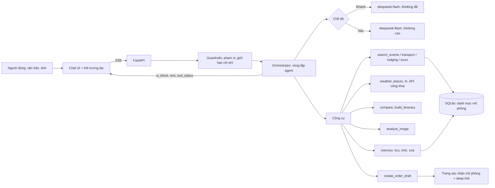

# Kế hoạch triển khai: Siêu trợ lý AI đặt vé, du lịch và giải trí (kiến trúc theo Muse Spark)

Dự thi MoMo TechDay 2026, chủ đề **Trợ lý AI**. Một người thực hiện.

## Trạng thái triển khai

Mã cho Task 1 đến 11 đã viết, kiểm thử bằng LLM giả (125 test backend gồm 5 test giao diện bằng Chromium, 14 test frontend) và đã chạy với DeepSeek thật: thử API (chat, tool-calls kèm thinking, ảnh đều đạt, xem `docs/deepseek-spike.md`), chạy server thật, và chạy bộ đánh giá 55 ca (nhanh 54/55, sâu 55/55, xem `eval/results/latest.md`). Giao diện đã chạy thật trên Chromium bằng Playwright (máy tính và điện thoại, có ảnh chụp để rà soát). Bộ giữ riêng 31 ca đạt 30/31 ở cả hai chế độ. Docker image đã build và chạy thử cục bộ, thử tải 9 phiên song song với DeepSeek thật đạt 9/9. **Chưa deploy lên máy chủ công khai, chưa thử trên điện thoại thật.** Chi phí DeepSeek cho toàn bộ các lần thử và đánh giá khoảng 1 USD theo ước tính của code (giá cao điểm, không tính cache).

| Task                                         | Trạng thái                                                      | Còn lại                                                                    |
| -------------------------------------------- | ----------------------------------------------------------------- | ---------------------------------------------------------------------------- |
| 1 Khung, hợp đồng, thử DeepSeek, deploy  | Xong, trừ deploy                                                 | Deploy, xem CI chạy                                                         |
| 2 LLMClient, chat streaming, hai chế độ   | Xong, đã xác nhận với API thật                              |                                                                              |
| 3 Danh mục mô phỏng, công cụ tìm kiếm | Xong                                                              | Dữ liệu sinh bằng mã (không phải LLM sinh rồi duyệt tay)             |
| 4 Agent, guardrails phạm vi                 | Xong                                                              | Guardrails dựa vào prompt, cần đo bằng bộ đánh giá thật            |
| 5 Giao diện chat, thẻ tương tác         | Xong, đã kiểm tra bằng Playwright                             | Người dùng nên tự thử thêm trên điện thoại thật                  |
| 6 So sánh, lịch trình                     | Xong, test tính nhất quán chi phí                             |                                                                              |
| 7 Đa phương thức                         | Xong, API nhận ảnh                                              | Mới thử ảnh đơn sắc, chưa thử ảnh thật. Có cờ `IMAGES_ENABLED` |
| 8 Bộ nhớ cá nhân hoá                    | Xong                                                              |                                                                              |
| 9 Đơn nháp, xác nhận, deep link         | Xong, test end-to-end qua HTTP                                    |                                                                              |
| 10 Đăng nhập demo, an toàn, chi phí     | Xong                                                              | Cần đổi mật khẩu demo khi deploy, xem chi phí thật                    |
| 11 Bộ đánh giá                           | Xong, đã chạy thật                                            | Số liệu là trên bộ phát triển, xem hạn chế trong `eval/README.md` |
| 12 Bài nộp                                 | Bản nháp tài liệu trong `docs/`, script zip có quét khóa | Xuất PDF hướng dẫn và slide, quay video, điền số liệu và link      |

**Khác với kế hoạch gốc**

- Ảnh gửi trực tiếp trong tin nhắn cho `deepseek-flash`, không có công cụ `analyze_image` (đỡ một vòng gọi LLM, đúng tinh thần đa phương thức gốc).
- Địa điểm tham quan là danh sách tuyển chọn (tọa độ gần đúng) thay vì gọi API bản đồ. Chỉ thời tiết gọi API ngoài (Open-Meteo). Chưa làm tỷ giá.
- Kiểm thử đầu-cuối dùng Playwright với LLM giả (`backend/tests/test_e2e_ui.py`) cộng test HTTP.
- Thêm ngoài kế hoạch: lưu hội thoại, vé khứ hồi, đồng hồ đếm ngược đơn nháp, nút Dừng, hiển thị markdown.
- Thêm `thinking` vào các loại sự kiện SSE để giao diện hiện "Đang suy luận".
- Chưa làm: điều phối nhiều agent song song (đã loại khỏi phạm vi từ đầu).

## 1. Bài toán

Dựng một trợ lý AI hội thoại theo kiến trúc hệ thống của Muse Spark (Meta), giới hạn ở vé giải trí, vé di chuyển, lưu trú và tour. Sản phẩm phải dùng thử được trực tuyến.

## 2. Yêu cầu

**Từ người dùng**

- Phạm vi: vé giải trí (phim, concert, sự kiện), vé di chuyển (máy bay, tàu, xe khách), lưu trú và tour. Câu hỏi ngoài phạm vi thì từ chối lịch sự.
- Thành phần lấy từ Muse: tool-use kèm giao diện thẻ tương tác, đa phương thức (gửi ảnh), chế độ nhanh và chế độ suy luận sâu, bộ nhớ cá nhân hoá. Điều phối nhiều agent song song không làm.
- Hành động: tư vấn, so sánh, tạo đơn nháp rồi dẫn tới trang xác nhận mô phỏng. AI không tự thanh toán.
- LLM: DeepSeek API.
- Dữ liệu: giả lập danh mục vé, kết hợp API công khai (thời tiết, bản đồ, tỷ giá). Phải ghi rõ là dữ liệu mô phỏng trong README và slide.
- Một người làm toàn bộ, công nghệ do người thực hiện chọn.

**Từ đề bài MoMo TechDay 2026**

- Sản phẩm dùng thử được trực tuyến, ban giám khảo tự dùng, không phụ thuộc máy local. AI là thành phần cốt lõi.
- Bài nộp gồm 4 thành phần:
  1. PDF hướng dẫn tối đa 1 trang A4, có link sản phẩm và tài khoản dùng thử.
  2. File .zip mã nguồn, README ghi cách chạy, công nghệ, tài sản có sẵn, thư viện mã nguồn mở, công cụ AI đã dùng.
  3. Slide PDF tối đa 10 trang (không sửa được sau khi nộp).
  4. Video MP4 tối đa 3 phút, quay sản phẩm đang chạy thật.
- Thời gian theo đề: vòng loại 20/11 – 3/12, chung kết 11/12. **Cần xác nhận lại hạn nộp trên trang chính thức.**

## 3. Kết quả nghiên cứu

- Muse Spark là mô hình đóng, Meta không công bố kiến trúc mạng hay trọng số. "Giữ kiến trúc" nghĩa là dựng lại các lớp hệ thống: tool-use, suy luận, đa phương thức, giao diện tương tác, cá nhân hoá, guardrails.
- `deepseek-flash` hỗ trợ vision, tool-calls, và bật hoặc tắt thinking (chỉnh `reasoning_effort`). `deepseek-v4-pro` có tool-calls và thinking nhưng không có vision. Giá thấp (khoảng 0.15 đến 0.3 USD cho 1 triệu token đầu vào, 0.6 đến 1.2 USD cho 1 triệu token đầu ra).
- Khi dùng thinking kèm tool-calls, mỗi lượt gọi phải gửi lại `reasoning_content` của các lượt trước. Thinking mode bỏ qua `temperature`.
- Chưa rõ định dạng gửi ảnh vào API. Task 1 có bước thử để xác nhận.
- Nguồn: [Muse Spark](https://ai.meta.com/blog/introducing-muse-spark-msl/), [DeepSeek Models &amp; Pricing](https://api-docs.deepseek.com/quick_start/pricing), [DeepSeek Thinking Mode](https://api-docs.deepseek.com/guides/thinking_mode).

## 4. Quyết định về đặt vé thật

Không tự động hoá thao tác trên website đặt vé thật (Playwright đến bước thanh toán). Lý do: điều khoản của nhiều trang cấm tự động hoá, có captcha, đăng nhập và OTP, thao tác điền form có thể giữ chỗ hoặc tạo đơn thật, và luồng phụ thuộc trang ngoài có thể hỏng khi ban giám khảo chấm.

Thay vào đó: dữ liệu giả lập kết hợp API công khai, và nút "Mở trang đối tác" ở trang xác nhận dẫn tới trang tìm kiếm thật của đối tác với tham số điền sẵn (deep link).

## 5. Công nghệ

| Thành phần      | Lựa chọn                                                                                                                                         |
| ----------------- | -------------------------------------------------------------------------------------------------------------------------------------------------- |
| Backend           | Python 3.12, FastAPI                                                                                                                               |
| Cơ sở dữ liệu | SQLite                                                                                                                                             |
| LLM               | SDK `openai` trỏ về base URL của DeepSeek, mô hình chính `deepseek-flash`                                                                |
| Streaming         | SSE                                                                                                                                                |
| Frontend          | React, Vite, TypeScript                                                                                                                            |
| Triển khai       | Một container, FastAPI phục vụ cả frontend đã build. Fly.io hoặc Render gói trả phí nhỏ để không bị "ngủ đông". Chốt ở Task 1. |

## 6. Kiến trúc

**Ánh xạ từ Muse Spark**

| Thành phần của Muse Spark | Cách làm trong sản phẩm                                                         |
| ---------------------------- | ----------------------------------------------------------------------------------- |
| Đa phương thức           | Người dùng gửi ảnh (địa điểm, poster, vé), `deepseek-flash` phân tích |
| Tool-use                     | Agent gọi công cụ tìm vé, thời tiết, địa điểm, so sánh, lịch trình    |
| Reasoning                    | Chế độ nhanh (thinking tắt) và chế độ sâu (thinking bật)                  |
| Interactive displays         | Khối `ui_block`: thẻ vé, bảng so sánh, dòng thời gian lịch trình         |
| Cá nhân hoá               | Bộ nhớ sở thích theo người dùng, xem và xoá được                        |
| Guardrails                   | Lọc phạm vi, chống prompt injection, trần chi phí, chỉ tạo đơn nháp       |
| Multi-agent (Contemplating)  | Không làm trong phạm vi này                                                     |

**Nguyên tắc thiết kế**

1. Giá, ngày giờ, số chỗ trống đến từ công cụ và SQL. LLM chỉ hiểu nhu cầu, chọn công cụ và diễn giải.
2. Agent chỉ có `create_order_draft`. Không có công cụ nào hoàn tất thanh toán.
3. Nội dung trong dữ liệu vé và ảnh người dùng gửi là dữ liệu không đáng tin, không được điều khiển agent.
4. Khóa API chỉ ở backend và biến môi trường. Có giới hạn tần suất và trần chi phí.
5. Deploy ngay từ đầu.

## 7. Chi tiết các task

### Task 1: Hợp đồng, khung dự án, thử DeepSeek, deploy sớm

- **Mục tiêu:** có bản chạy online gọi được LLM thật, và chốt các điểm chưa chắc về DeepSeek.
- **Hướng dẫn:**
  - Thư mục `backend/`, `frontend/`, `data/`, `eval/`, `contracts/`, `docs/`.
  - Viết vào `contracts/` các schema dữ liệu (sự kiện, chuyến di chuyển, lưu trú, tour, đơn nháp), chữ ký công cụ và định dạng sự kiện SSE (`text_delta`, `tool_status`, `ui_block`, `done`).
  - Thử nhanh: gọi tool-calls kèm thinking, gửi một ảnh vào `deepseek-flash`, xác nhận cách gửi ảnh và giới hạn kích thước.
  - `.env.example`, `.gitignore` chặn `.env`. Deploy một container, thêm CI chạy test.
- **Kiểm thử:** `/health`, cấu hình thiếu khoá báo lỗi rõ.
- **Demo:** URL công khai trả về một câu trả lời từ DeepSeek.

### Task 2: LLMClient và chat streaming, hai chế độ

- **Mục tiêu:** hội thoại streaming, chuyển được giữa chế độ nhanh và chế độ sâu.
- **Hướng dẫn:**
  - `LLMClient` đọc `LLM_BASE_URL`, `LLM_MODEL`, `LLM_API_KEY` từ môi trường, có hàm chat, tool-calling, và bản giả cho test.
  - Chế độ nhanh tắt thinking. Chế độ sâu bật thinking với `reasoning_effort=high`. Ghi nhận token và chi phí mỗi lượt.
  - Endpoint `POST /chat` trả SSE. Xử lý việc gửi lại `reasoning_content` khi có tools.
- **Kiểm thử:** LLM giả cho test đơn vị, test định dạng SSE, test chuyển chế độ.
- **Demo:** trình duyệt hoặc `curl` nhận phản hồi từng phần ở cả hai chế độ.

### Task 3: Danh mục mô phỏng và công cụ tìm kiếm

- **Mục tiêu:** có dữ liệu đủ đa dạng cho cả ba nhóm vé.
- **Hướng dẫn:**
  - SQLite với vài trăm bản ghi mỗi nhóm: sự kiện, chuyến bay, tàu, xe khách, khách sạn, tour. Dữ liệu có giá, ngày giờ, số chỗ, đánh giá.
  - Dùng LLM sinh dữ liệu rồi duyệt tay để tự nhiên.
  - Công cụ `search_events`, `search_transport`, `search_lodging`, `search_tours`. Thêm `get_weather` và `get_places` từ API công khai, có cache và dự phòng khi API ngoài lỗi.
- **Kiểm thử:** lọc theo giá, ngày, địa điểm. API ngoài lỗi vẫn trả kết quả dự phòng.
- **Demo:** lệnh dòng lệnh tìm "chuyến bay Hà Nội đi Đà Nẵng cuối tuần dưới 2 triệu".

### Task 4: Agent tool-calling và guardrails phạm vi

- **Mục tiêu:** từ một câu nhu cầu tiếng Việt ra kết quả đúng công cụ, đúng ràng buộc.
- **Hướng dẫn:**
  - Vòng lặp agent với giới hạn bước, timeout và xử lý lỗi công cụ.
  - Prompt hệ thống: chỉ phục vụ đặt vé, du lịch, giải trí, hỏi lại tối đa 1 đến 2 câu khi thiếu thông tin, trả lời tiếng Việt, không nghe theo nội dung trong dữ liệu.
  - Bộ lọc phạm vi: câu ngoài chủ đề thì từ chối lịch sự và gợi ý quay lại phạm vi.
- **Kiểm thử:** mock LLM cho test đơn vị. Bộ khoảng 30 truy vấn đo tỷ lệ gọi đúng công cụ và đúng ràng buộc, có thêm ca ngoài phạm vi.
- **Demo:** "đặt cho tôi vé xem phim cuối tuần này ở Sài Gòn dưới 150 nghìn" nhận danh sách phù hợp. "Giải bài toán giúp tôi" bị từ chối.

### Task 5: Giao diện chat và thẻ tương tác

- **Mục tiêu:** trải nghiệm hoàn chỉnh cho bước tìm và chọn.
- **Hướng dẫn:**
  - Chat streaming, hiển thị tiến trình (đang tìm chuyến bay...), nút chuyển chế độ nhanh và sâu.
  - Các khối `ui_block`: thẻ vé, bảng so sánh, dòng thời gian lịch trình, mỗi khối có nút hành động.
  - Câu mẫu để ban giám khảo bấm thử. Xử lý trạng thái tải, lỗi, mạng chậm. Dùng được trên điện thoại.
- **Kiểm thử:** test thành phần, một test đầu-cuối cơ bản bằng Playwright.
- **Demo:** trên trình duyệt, từ câu nhu cầu đến thẻ vé có thể bấm.

### Task 6: So sánh và lập lịch trình

- **Mục tiêu:** năng lực nổi bật của chế độ suy luận sâu.
- **Hướng dẫn:**
  - Công cụ `compare_options` và `build_itinerary`: ghép di chuyển, lưu trú, hoạt động theo ngân sách và thời tiết.
  - Chế độ sâu dùng cho yêu cầu nhiều ràng buộc, chế độ nhanh cho tìm đơn giản.
  - Hiển thị lịch trình bằng dòng thời gian trong giao diện.
- **Kiểm thử:** tổng chi phí khớp với tổng các mục, ràng buộc ngày giờ không chồng chéo.
- **Demo:** "lên kế hoạch 3 ngày ở Đà Lạt cho 2 người, ngân sách 8 triệu" ra lịch trình có tổng chi phí.

### Task 7: Đa phương thức

- **Mục tiêu:** người dùng gửi ảnh để hỏi.
- **Hướng dẫn:**
  - Công cụ `analyze_image` gọi `deepseek-flash` với ảnh, rút ra địa điểm, loại sự kiện hoặc nội dung vé.
  - Kiểm tra kích thước và loại tệp. Xoá ảnh sau khi xử lý. Coi chữ trong ảnh là dữ liệu không đáng tin.
  - Nối kết quả vào luồng tìm kiếm, ví dụ ảnh poster concert dẫn tới tìm vé concert.
- **Kiểm thử:** ảnh sai định dạng hoặc quá lớn, ảnh có chữ chứa chỉ thị độc hại.
- **Demo:** gửi ảnh một địa điểm du lịch, nhận gợi ý và tìm chuyến đến đó.

### Task 8: Bộ nhớ cá nhân hoá

- **Mục tiêu:** trợ lý nhớ sở thích giữa các phiên.
- **Hướng dẫn:**
  - Bảng bộ nhớ theo người dùng (ngân sách thường dùng, hãng ưa thích, thành phố xuất phát, sở thích giải trí). Công cụ `save_preference` và `recall_memory`.
  - Chỉ lưu khi người dùng nêu rõ hoặc đồng ý. Có trang xem và xoá bộ nhớ.
  - Không lưu dữ liệu nhạy cảm như số thẻ hay CCCD.
- **Kiểm thử:** lưu, nhớ, xoá. Bộ nhớ của người dùng này không lộ sang người dùng khác.
- **Demo:** nói "tôi hay đi từ Hà Nội, thích khách sạn có hồ bơi", phiên sau trợ lý tự áp dụng.

### Task 9: Đơn nháp, trang xác nhận mô phỏng và deep link

- **Mục tiêu:** hoàn tất luồng từ nhu cầu đến xác nhận.
- **Hướng dẫn:**
  - `create_order_draft` chỉ tạo đơn nháp. Trang xác nhận hiển thị sản phẩm, giá, phí, điều kiện hoàn huỷ, và nút "Xác nhận" (mô phỏng).
  - Nút "Mở trang đối tác" dẫn tới deep link có tham số điền sẵn.
  - Chỉ thao tác của người dùng trên trang mới chuyển đơn sang đã xác nhận.
  - Kiểm tra lại giá và số chỗ tại thời điểm xác nhận.
- **Kiểm thử:** agent không thể đặt trạng thái hoàn tất. Giá đổi hoặc hết chỗ thì báo lại.
- **Demo:** đi hết luồng đến màn hình "xác nhận thành công" (mô phỏng), và nhánh hết chỗ.

### Task 10: Đăng nhập demo, an toàn và kiểm soát chi phí

- **Mục tiêu:** chịu được người dùng lạ mà không vượt ngân sách.
- **Hướng dẫn:**
  - Tài khoản demo cho ban giám khảo. Giới hạn tần suất theo người dùng và trần chi phí mỗi ngày, kèm thông báo thân thiện.
  - Cache cho câu mẫu, dùng chế độ nhanh làm mặc định.
  - Xử lý lỗi LLM, timeout, hết hạn mức.
  - Kiểm thử prompt injection trong dữ liệu vé và ảnh. Kiểm tra khoá API không lộ trong phản hồi, log hay file nộp.
- **Kiểm thử:** test injection, giới hạn tần suất, trần chi phí, khi LLM lỗi vẫn trả thông báo thân thiện.
- **Demo:** thử trên điện thoại và mạng khác bằng tài khoản demo, xem bảng chi phí ghi nhận.

### Task 11: Bộ đánh giá

- **Mục tiêu:** có số liệu cho slide.
- **Hướng dẫn:**
  - Khoảng 50 câu nhu cầu kèm đáp án mong muốn, gồm ca ngoài phạm vi và ca ảnh.
  - Chỉ số: tỷ lệ gọi đúng công cụ, tỷ lệ đúng ràng buộc giá và ngày, tỷ lệ từ chối đúng, tổng chi phí khớp, độ trễ và chi phí mỗi yêu cầu. So sánh chế độ nhanh và chế độ sâu.
  - Một lệnh chạy toàn bộ và xuất bảng. Ước tính trước số lần gọi API.
- **Kiểm thử:** script đo chạy đúng trên dữ liệu nhỏ có đáp án biết trước.
- **Demo:** một lệnh ra bảng so sánh sẵn sàng cho slide.

### Task 12: Hoàn thiện bài nộp

- **Mục tiêu:** nộp đủ, đúng định dạng, có thời gian dự phòng.
- **Hướng dẫn:**
  - PDF hướng dẫn 1 trang A4 với link sản phẩm, tài khoản demo và vài câu mẫu.
  - Zip mã nguồn kèm README ghi cách chạy, công nghệ, tài sản có sẵn, thư viện mã nguồn mở và công cụ AI đã dùng. **Kiểm tra zip không chứa `.env` hay khoá API.**
  - Slide tối đa 10 trang: vấn đề, giải pháp, kiến trúc theo Muse Spark, kết quả đánh giá, hạn chế, ghi rõ dữ liệu mô phỏng.
  - Video MP4 tối đa 3 phút quay sản phẩm chạy thật.
  - Chạy thử như ban giám khảo, từ máy chưa từng dùng.
- **Demo:** bốn tệp nộp hoàn chỉnh, đã kiểm tra, nộp trước hạn.

## 8. Rủi ro và cách giảm

| Rủi ro                                       | Cách giảm                                                                                           |
| --------------------------------------------- | ----------------------------------------------------------------------------------------------------- |
| Chưa rõ cách gửi ảnh vào DeepSeek       | Thử ở Task 1. Nếu không dùng được thì cắt Task 7                                            |
| Chi phí API khi nhiều người thử          | Trần chi phí, cache, chế độ nhanh mặc định (Task 10)                                          |
| Phạm vi lớn cho một người                | Thứ tự cắt khi trễ: Task 8, rồi Task 7, rồi Task 6. Task 1 đến 5, 9, 10 và 12 là phần lõi |
| API công khai bên ngoài lỗi               | Cache và dữ liệu dự phòng (Task 3)                                                               |
| Hợp đồng dữ liệu thay đổi giữa chừng | Chốt ở Task 1, chỉ sửa khi cập nhật cả backend và frontend                                    |
| Hạn nộp lệch ước tính                   | Xác nhận lại ngày trên trang chính thức                                                        |
| Lộ khoá API                                 | Khoá chỉ ở backend, kiểm tra ở Task 10 và 12                                                    |

## 9. Định nghĩa hoàn thành

- Ban giám khảo mở link, đăng nhập bằng tài khoản demo, nói một nhu cầu và đi tới trang xác nhận mà không cần hướng dẫn thêm.
- Câu hỏi ngoài phạm vi bị từ chối đúng, và agent không có đường nào hoàn tất thanh toán.
- Bảng đánh giá nằm trong slide.
- Bốn thành phần bài nộp đã được kiểm tra và nộp trước hạn.

## 10. Việc cần xác nhận

1. Hạn nộp chính xác trên trang chính thức.
2. Nơi deploy (Fly.io hoặc Render) và ngân sách API.
3. Định dạng gửi ảnh của DeepSeek, xác nhận ở Task 1.

---

# Giai đoạn 2: Trợ lý chuyến đi trên ví MoMo (kết hợp 4 loại trợ lý và chủ đề Chống lừa đảo)

Quyết định ngày 24/11/2026. Mục tiêu: một hành trình liền mạch từ lúc muốn đi đến lúc về, phủ các loại trợ lý của đề (trừ Trợ lý bán hàng) và chủ đề Chống lừa đảo, mà không bỏ phần đã kiểm chứng ở giai đoạn 1.

| Loại trợ lý của đề        | Việc trong sản phẩm                                                |
| ------------------------------- | --------------------------------------------------------------------- |
| Mua sắm                        | Tìm, so sánh, lập kế hoạch (đã có), gợi ý trả lời nhanh   |
| Cá nhân                       | Bộ nhớ (đã có), "Đơn và chuyến đi sắp tới"                |
| Thanh toán                     | Đơn nháp, xác nhận (đã có), lịch sử đơn, chia tiền nhóm |
| Tài chính                     | Ngân sách chuyến đi, theo dõi chi so với ngân sách            |
| Chống lừa đảo (chủ đề 2) | Kiểm tra link và tin nhắn người bán                             |

Không làm: Trợ lý bán hàng, lời khuyên đầu tư, vay, thuế, chuyển tiền thật, điều phối nhiều agent.

## Task 13: Đơn của tôi và chuyến đi sắp tới

- **Mục tiêu:** người dùng xem lại mọi đơn, biết chuyến sắp tới.
- **Làm:** thêm `when_at` cho mục đơn và `trip_id` cho đơn (di trú DB không mất dữ liệu), `GET /orders`, công cụ `get_my_orders`, trang `#/orders` có mục "Sắp tới", "Đơn nháp còn hạn", "Lịch sử".
- **Kiểm thử:** di trú trên DB cũ, đơn của người này không lộ cho người khác, sắp xếp theo thời gian, giao diện bằng Chromium.

## Task 14: Gợi ý trả lời nhanh

- **Làm:** hàm thuần sinh gợi ý từ các khối kết quả cuối (không gọi LLM), hiển thị dưới tin nhắn cuối của trợ lý.
- **Kiểm thử:** unit test cho từng loại khối, test giao diện bấm gợi ý.

## Task 15: Kiểm tra link và tin nhắn lừa đảo

- **Làm:** bộ luật xác định `scamcheck.py` (tín hiệu văn bản tiếng Việt, phân tích URL: giả mạo thương hiệu, rút gọn link, TLD đáng ngờ, IP, punycode, thủ thuật `@`), công cụ `check_scam`, khối `risk_report`. Kết quả nói "dấu hiệu rủi ro", không kết luận "lừa đảo".
- **Kiểm thử:** bộ ca có nhãn đo precision, recall, tỷ lệ báo nhầm trên tin nhắn bình thường (chạy offline, không tốn chi phí), cộng ca định tuyến qua agent thật.

## Task 16: Ngân sách chuyến đi

- **Làm:** bảng `trips`, `expenses`; công cụ `create_trip`, `add_expense`, `get_trip_budget`; `create_order_draft` nhận `trip` tùy chọn, đơn đã xác nhận của chuyến tự tính vào chi tiêu; khối `budget_status` có thanh tiến độ và mức cảnh báo.
- **Kiểm thử:** số liệu tính bằng SQL khớp tay, đơn chưa xác nhận không tính, cách ly giữa người dùng, giới hạn đầu vào.

## Task 17: Chia tiền nhóm

- **Làm:** `split_bill` xác định (chia đều, theo tỷ trọng, có người ứng tiền), tổng các phần luôn bằng tổng tiền, kèm tin nhắn nhắc trả (chỉ là văn bản, không gửi thật), khối `split_result`.
- **Kiểm thử:** thuộc tính bằng dữ liệu ngẫu nhiên (tổng khớp, lệch nhau tối đa 1đ), đầu vào sai.

## Task 18: Prompt, giới hạn tài chính, hợp đồng, đánh giá

- **Làm:** cập nhật phạm vi và quy tắc (không tư vấn đầu tư, vay, thuế), hợp đồng `contracts/`, thêm ca đánh giá giai đoạn 2, chạy lại cả ba bộ ca với DeepSeek thật.
- **Kiểm thử:** các ca từ chối cũ vẫn đạt, ca mới đạt, báo cáo trung thực về hạn chế.

## Task 19 (cắt đầu tiên nếu trễ): Nhập bằng giọng nói

- **Làm:** nút micro dùng Web Speech API của trình duyệt, ẩn nếu không hỗ trợ.

## Trạng thái giai đoạn 2 (cập nhật 24/11/2026)

Task 13 đến 19 đã làm xong và kiểm thử: 180 test backend (gồm 8 test giao diện bằng Chromium), 25 test frontend. Chạy thật với DeepSeek: bộ giai đoạn 2 đạt 21/23 (nhanh) và 23/23 (sâu), hồi quy bộ phát triển 55/55 và bộ giữ riêng 31/31 (nhanh).

| Task                                  | Trạng thái | Lưu ý                                                                                                                                                                                                                                   |
| ------------------------------------- | ------------ | ----------------------------------------------------------------------------------------------------------------------------------------------------------------------------------------------------------------------------------------- |
| 13 Đơn của tôi, chuyến sắp tới | Xong         | Di trú DB cũ có test                                                                                                                                                                                                                   |
| 14 Gợi ý trả lời nhanh            | Xong         | Sinh bằng luật ở frontend, không gọi LLM                                                                                                                                                                                             |
| 15 Kiểm tra lừa đảo               | Xong         | Bộ giữ riêng 36 ca: precision 100%, recall 78% (cảnh báo) và 56% (nguy cơ cao), báo nhầm 0%. Bỏ sót tin diễn đạt khác thường. Bộ phát triển đã dùng để chỉnh luật nên số liệu của nó không có ý nghĩa |
| 16 Ngân sách chuyến đi            | Xong         | Bắt được lỗi làm tròn ở ngưỡng cảnh báo bằng test biên                                                                                                                                                                      |
| 17 Chia tiền nhóm                   | Xong         | Kiểm thử thuộc tính: tổng luôn khớp, lệch tối đa 1đ                                                                                                                                                                            |
| 18 Prompt, hợp đồng, đánh giá   | Xong         | Chi phí ước tính mỗi lượt tăng khoảng 35% do danh sách công cụ dài hơn                                                                                                                                                      |
| 19 Nhập giọng nói                  | Xong         | Chỉ kiểm thử logic và phát hiện hỗ trợ. Chưa thử nói thật, chưa thử trên Safari và Firefox (không hỗ trợ)                                                                                                              |

Chưa làm: deploy lên máy chủ công khai, PDF hướng dẫn và slide (đã có bản nháp nội dung cập nhật trong `docs/`), video, thử trên điện thoại thật, đo riêng phần nhận định bổ sung của mô hình cho kiểm tra lừa đảo.

## Thứ tự và thứ tự cắt

Làm theo thứ tự 13 → 14 → 15 → 16 → 17 → 18 → 19. Nếu trễ, cắt: 19, rồi 17, rồi 16. Task 15 giữ lại cuối cùng vì thuộc chủ đề thứ hai của đề.
